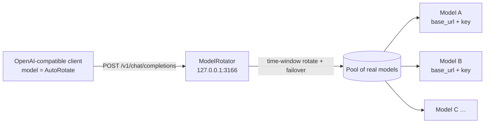
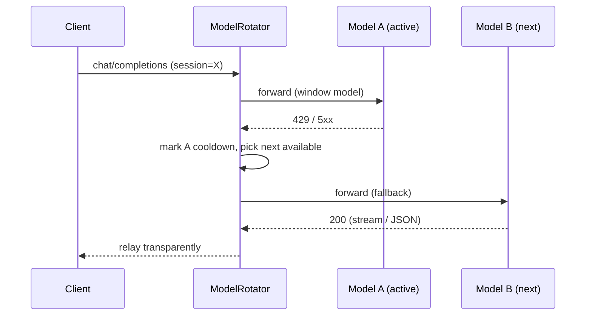

# ModelRotator

> 本地 OpenAI 兼容的「模型定时轮换代理」。在多个上游模型之间按时间窗轮换，命中限流/5xx 时自动跳过并冷却，对客户端只暴露一个统一的 `AutoRotate` 模型。零第三方依赖，仅用 Python 标准库。

**ModelRotator** is a local, OpenAI-compatible proxy that rotates upstream models on a timer and fails over on rate-limits. Clients talk to a single endpoint/model; the proxy fans requests out across a pool of real models. No third-party dependencies — Python standard library only.

---

## 它解决什么问题

把多个供应商/自定义模型接进一个 OpenAI 兼容客户端（如各类 IDE 插件、CLI、自研 Agent）时，单个模型很容易被限流（429）或偶发 5xx。直接固定用一个模型，高峰就卡住；手动换模型又打断工作流。

ModelRotator 在它们之上再放一层：

- 客户端只配置一个 `AutoRotate` 模型，指向本代理；
- 代理按「时间窗轮换 + 失败自动跳过并冷却」把请求路由到池内真实模型；
- 对客户端完全透明（标准 `/v1/chat/completions` 与 `/v1/responses`，均支持 SSE 流式透传）。

## 特性

- **零依赖**：仅 Python 标准库。
- **时间窗轮换**：每 `rotate_minutes` 切到池内下一个模型；同一会话在窗内粘住同一模型，避免上下文跨模型跳变。
- **失败转移**：命中 `fail_status`（429/5xx 等）或异常 → 该模型进入 `cooldown_minutes` 冷却，立刻改投下一个可用模型。
- **池内全冷却**：清除冷却重试一轮；仍不行则返回 429 并带 `X-Rotate-Reason`。
- **完整透传**：流式 SSE / chunked 与非流式 JSON 都原样转发；逐条携带各自的 `base_url` 与 `api_key`。
- **会话粘性（窗内）**：同一 `X-Rotate-Session` / `user` 在**一个时间窗内**恒定路由到同一模型，避免多轮对话上下文跨模型跳变；窗口到点后该会话自动跟随轮换（不会永久钉死在首个模型）。
- **并发按账号分片**：同一时刻有多个任务在跑时，按各 `account` 的在途请求数分流，把并发摊到不同上游账号；顺序请求仍保持粘性。多个任务共用一个默认会话也照样分开。
- **看门狗（可选）**：首选模型超过 `hedge_after_seconds` 仍没回响应头（上游沉默而非慢）时，并发第二路换账号抢答，取先到的；正常请求零额外开销。见下方专节。
- **内置控制面**：手动切换模型 / 快速刷新 / 赋权重 / 池成员启停 / 清冷却，全部**免重启**生效，有 HTTP API、Web 控制台、命令行开关三个入口。见下方专节。
- **单实例保护**：启动前先探测本机端口健康，已有实例在跑则主动退出，避免端口互抢。
- **只读上游清单**：从 `source_models_json` 读取密钥，绝不回写。

## 工作原理



**一次失败转移（429 → 冷却 → 改投）的时序：**



路由策略：

1. **时间窗**：每 `rotate_minutes` 切到池内下一个模型。同一会话在**当前窗内**粘住同一模型，避免上下文跨模型跳变；窗口到点后该会话跟随轮换到下一个模型（不再被永久钉死）。
2. **失败转移**：命中 `fail_status`（429/5xx）或异常 → 该模型进入 `cooldown_minutes` 冷却，立刻改投池内下一个可用模型。
3. **池内全冷却**：清除冷却重试一轮；仍不行则返回 429 并带 `X-Rotate-Reason`。

## 快速开始

```bash
# 1) 准备配置（复制示例并按需修改）
cp config.example.json config.json

# 2) 前台运行（看到日志即成功）
python rotator.py

# 3) 健康检查
curl http://127.0.0.1:3166/health
# => {"ok":true,"active_model":"...","uptime_seconds":...}
```

客户端把 `base_url` 设为 `http://127.0.0.1:3166/v1`，`model` 设为 `config.json` 里的 `expose_as`（示例为 `AutoRotate`），`api_key` 随便填（代理不校验客户端 key）。

## 分发：单文件 EXE（Windows）

不想装 Python？直接给一台 Windows 机器发一个 `ModelRotator.exe` 就能用（GitHub Releases 页面有预构建产物）。

```powershell
# 在源码目录（需要 Python 环境）本地构建：
pip install pyinstaller
python build_exe.py           # 产物: dist/ModelRotator.exe (~9.6 MB, 单文件)
python build_exe.py --console # 保留控制台窗口，方便看日志
```

**分发与首次使用**：

1. 把 `ModelRotator.exe` 复制到接收方机器的任意目录（建议 `C:\tools\ModelRotator\`）；
2. 双击运行——首次启动会自动在 exe 同目录生成一份 `config.json`（基于内置的 `config.example.json` 模板）；
3. 编辑 `config.json`，把 `pool` 里的 `url`/`key` 换成你自己的上游模型（或用字符串 id 引用 `models.json`）；
4. 重新运行 exe，服务即监听默认 `127.0.0.1:3166`；
5. 客户端 `base_url` 填 `http://127.0.0.1:3166/v1`，`model` 填 `AutoRotate`。

配置不在 exe 旁边？用 `--config` 指过去，`overrides.json` 和日志会跟随它所在目录：

```powershell
ModelRotator.exe --config D:\somewhere\config.json
```

**v1.1 起 exe 是自包含的**：代理 + 控制面（手动切换 / 快速刷新 / 赋权重）+ 进程与计划任务管理全在一个文件里，不再需要 `pythonw.exe`、`rotator-ctl.ps1` 或计划任务里那一串 python 路径。日常使用：

```powershell
ModelRotator.exe                 # 启动（无窗口，日志写 rotator.log）
ModelRotator.exe --open-console  # 打开控制台
ModelRotator.exe --status        # 看状态
ModelRotator.exe --kill          # 全部关掉
```

要开机自启 + 保活，一条命令注册指向自己的计划任务（exe 有单实例保护，重复拉起会自动退出）：

```powershell
ModelRotator.exe --install-task
```

**GitHub Actions 自动发布**：打 `vX.Y.Z` 标签推送后，仓库的 `.github/workflows/release.yml` 会在 Windows runner 上跑测试 + 构建 exe + 创建 Release 并挂载 `ModelRotator.exe` 与 `config.example.json` 资产。

```bash
git tag v1.0.0
git push origin v1.0.0
# Actions 完成 => 自动生成 Release，exe 可下载
```

> **SmartScreen 提示**：未签名的 exe 首次运行会弹「Windows 已保护你的电脑」，点「更多信息 → 仍要运行」即可。正式分发建议申请代码签名证书（如 DigiCert / Sectigo EV）对 exe 签名。

> **说明**：exe 由 PyInstaller 从同一个 `rotator.py` 打包，行为与源码版完全一致；配置文件、日志都写在 exe 所在目录（不是临时解压目录），升级/迁移只需搬 exe + config.json。

## 配置（`config.json`）

| 字段 | 说明 | 默认 |
|------|------|------|
| `listen_host` | 监听地址 | `127.0.0.1` |
| `listen_port` | 监听端口 | `3166` |
| `rotate_minutes` | 时间窗长度（分钟） | `30` |
| `cooldown_minutes` | 失败模型冷却时长（分钟） | `10` |
| `fail_status` | 触发冷却的 HTTP 状态码列表 | `[408,409,425,429,500,502,503,504]` |
| `fail_on_exception` | 连接异常是否也触发冷却 | `true` |
| `rotate_on_first_request` | 收到首个请求才推进时间窗（避免空窗消耗） | `true` |
| `source_models_json` | 密钥源文件（WorkBuddy 风格的 `models.json`，提供 `apiKey`） | `~/.workbuddy/models.json` |
| `pool` | 上游模型池，见下方三种写法 | 必填 |
| `expose_as` | 对客户端暴露的模型名 | `AutoRotate` |
| `account` | 池成员所属账号标签（可选，用于并发分片；缺省按模型 id 分桶） | 模型 id |
| `quality_priority` | 是否按质量分优先选模型（`false` 退回纯时间窗轮换） | `true` |
| `quality_scores` | `{"模型id": 0-100}`，质量分越高越优先；未写的按 50 | `{}` |
| `hedge_after_seconds` | 看门狗：等待上游响应头超过该秒数就并发第二路（`0` 关闭） | `0` |
| `hedge_max` | 看门狗最多并发几路（含首选；`0` 关闭） | `0` |
| `first_token_timeout_seconds` | 首 token 看门狗：响应头到手后流式首块超过该秒数不来就判死、走 fallback 链（`0` 关闭；仅流式生效） | `0` |
| `log_file` | 日志路径；省略则写到程序目录 `rotator.log` | 程序目录 |

### 池成员（`pool`）的三种写法

```jsonc
"pool": [
  // 1) 仅写 id：从 source_models_json 里取该模型的 url + api_key
  "gpt-4o-mini",

  // 1b) id@账号：同上，并标记它属于哪个上游账号（用于并发分片）
  "gpt-4o-mini@openai-main",
  "qwen-max@dashscope-a",

  // 2) 内联 url + 显式 key（自包含，不需要 source_models_json）
  { "id": "claude-3-5-haiku", "url": "https://api.anthropic.com/v1", "key": "sk-ant-...", "account": "anthropic" },

  // 3) 内联 url + 借用密钥：key 从 source_models_json 里某个 id 的 apiKey 取
  { "id": "my-model", "url": "http://127.0.0.1:9000/v1", "key_from": "gpt-4o-mini" }
]
```

> 形式 1/3 依赖 `source_models_json`（典型如 WorkBuddy 的 `~/.workbuddy/models.json`）。形式 2 完全自包含，适合对接任意 OpenAI 兼容网关。

### 并发分片（按账号）

同一时刻有多个任务在跑时，如果全都压在同一个上游账号上，限流会立刻打满。给池成员标上 `account` 后，代理会**按在途请求数分流**：

- 每个账号的在途请求数越少越优先，同负载时取离当前时间窗模型最近的；
- 顺序请求（同一会话、无并发）保持粘性，上下文不跳变；
- 并发请求会被摊到不同账号，最多摊到「账号数」路并行。

```jsonc
// 同一上游账号下的多个模型共用一个 account 名，代理视为同一资源，不会互相挤占
"pool": ["wb-deepseek@wb", "wb-glm@wb", "hy3@wb-multi"]
```

> 为什么要按「在途数」而不是按「会话」分片：多数客户端（含 WorkBuddy）不发 `X-Rotate-Session`，所有请求都落在同一个默认会话上，按会话分片等于没分片。按在途数分流才能保证并发任务真的落到不同账号。
> 不写 `account` 时默认按模型 id 分桶（一个模型算一个账号），同样能把并发摊开。

### 质量优先（可选）

只按时间窗轮换会把「能跑的模型」和「跑得好的模型」一视同仁。给模型打分后，代理优先用更好的那个：

```jsonc
"quality_priority": true,
"quality_scores": {
  "deepseek-v4.1-flash":  92,
  "Qwen3.8-Flash":        90,
  "hy3":                  85,
  "sensenova-6-8-flash":  80,
  "mimo-v2.6-flash-solo": 60,
  "glm-5.3-flash-solo":   55
}
```

选择顺序是**三级**的：`账号在途数` → `质量分（降序）` → `离当前时间窗的距离`。

- 账号在途数必须排第一位：否则多个并发任务会全压到质量最高那一个模型/账号上，立刻被限流。
- 质量分只影响「同等空闲」时的取舍，所以并发摊开与质量优先不冲突。
- 设 `quality_priority: false` 可完全退回旧行为（纯时间窗轮换）。

分数怎么来：用 `quality_eval.py` 实测（见下节），不要凭模型名字猜。

### 实测模型质量

```bash
python quality_eval.py --workers 6 --repeat 2
```

做法：把池里 29 个入口按家族去重（`wb-`/`wai-`/`catpaw-`/`sn-` 前缀、`-solo`/`-lite` 后缀归一），对每个家族发 12 道有唯一答案的题（算术、三段论、代码追踪、多约束排列、模幂、长串精确计数、布尔求值），自动判分，结果写 `quality_result.json`。

两个必须注意的坑（都已处理）：

- **推理模型读 `reasoning_content`**：像 `hy3` 这类模型会先把 token 烧在思考上，`max_tokens` 太小会导致 `content` 直接为空。脚本把上限提到 2048，并在 `content` 为空时回退读 `reasoning_content`。
- **判分只认 `ANSWER:` 行**：被评模型很啰嗦，解释里全是中间数字，宽松匹配会把 `20 × 7 = 140` 里的 20 当成答案。脚本要求模型最后一行输出 `ANSWER: <答案>`，判分只读这一行。

## 控制脚本（Windows）

`rotator-ctl.ps1` 用 PowerShell 管理进程，并能注册「开机自启 + 5 分钟保活」的计划任务：

```powershell
powershell -ExecutionPolicy Bypass -File rotator-ctl.ps1 status        # 查看状态
powershell -ExecutionPolicy Bypass -File rotator-ctl.ps1 start         # 启动（优先用计划任务）
powershell -ExecutionPolicy Bypass -File rotator-ctl.ps1 stop          # 停止
powershell -ExecutionPolicy Bypass -File rotator-ctl.ps1 restart       # 重启
powershell -ExecutionPolicy Bypass -File rotator-ctl.ps1 install       # 注册开机自启计划任务
powershell -ExecutionPolicy Bypass -File rotator-ctl.ps1 uninstall     # 移除计划任务
powershell -ExecutionPolicy Bypass -File rotator-ctl.ps1 testautostart # 停→用计划任务起→验证
```

脚本自动定位 `pythonw.exe`：优先 `$env:PYTHONW` → 已注册计划任务里的解释器 → PATH 上的 `pythonw` → 否则回退 `pythonw.exe`。macOS / Linux 可去掉计划任务部分，直接用 `nohup python rotator.py &` 或 systemd 保活。

## 支持的请求端点

转发层支持同一 base 下的多个 OpenAI 兼容端点，共用同一套路由、冷却与失败转移：

| 客户端请求 | 转发到上游 | 说明 |
|-----------|-----------|------|
| `POST /v1/chat/completions` | `<base>/v1/chat/completions` | 对话补全，SSE 流式透传 |
| `POST /v1/responses` | `<base>/v1/responses` | OpenAI Responses API，SSE 事件流透传 |

两者都靠 body 里的 `model` 字段改写完成路由，`stream: true` 都走 SSE 透传，因此不需要格式转换。请求路径会去掉 query string 再判定（`/v1/responses?api-version=...` 可用），未知端点仍返回 404 并列出 `supported`。

> 注意：上游 URL 是按 `/v1/` 为锚点整体重建的。池成员的 url 固定存成 `.../v1/chat/completions`，若只替换最后一段会拼出 `/v1/chat/responses`（错误），所以 `upstream_url()` 保留 base 前缀、只换 `/v1/` 之后的部分。

## 看门狗（两阶段：首字节对冲 + 首 token 判死）

`hedge_after_seconds > 0` 且 `hedge_max > 1` 时启用**首字节对冲**；`first_token_timeout_seconds > 0` 时启用**首 token 判死**（仅流式）。两者相互独立，可只开一个。

**它解决什么**：上游有时不是「慢」，而是「沉默」——网关在 504 之前先静默 20-30 秒，或者模型算完超长上下文才报 `prompt is too long`。这类等待是纯浪费：客户端既拿不到内容，也拿不到错误。实测日志里 10 次失败有 6 次是这种形态（20.3s / 24.8s / 25.3s / 25.5s / 27.3s / 29.8s）。

**怎么工作**（两阶段）：

```
发请求到主模型
  ├─ hedge_after 秒内没收到响应头（首字节） → 立刻并发第二路（不同账号），取先到
  ├─ 响应头到手，但 first_token_timeout 秒内没收到首 token → 直接判死，走现有 fallback 链
  └─ 正常返回 → 完全不并发，零额外成本
```

- 阶段一（首字节对冲）：首选超时没回响应头 → 并发第二路，谁先拿到响应头谁赢，其余放弃。
- 阶段二（首 token 判死）：响应头已到、但流式首块迟迟不来（上游「伪活着」，连接不断也不出字）→ 把当前路标记冷却，交给常规失败转移链换路。判死只可能发生在给客户端写第一个字节**之前**。

关键实现点：

- `urllib` 的 `timeout` 是 **socket 级**超时（多久无数据断开），无法表达「N 秒内没响应头就放弃」。所以 `Attempt` 把 `open()` 放进旁路线程，主线程只等 `Event`，等待超时不会泄漏线程——后台线程最终自己结束，只是结果被丢弃。
- 首 token 判死复用 socket 级超时：拿到响应后把 `first_token_timeout_seconds` 临时设到上游 socket 上读第一个数据块，读到（或对端正常关闭）后立刻恢复原超时，后续流式透传不受影响。
- 只有当**首块数据**真正要写出时才算赢。一旦开始往客户端写字节就不能再切换，所以两阶段看门狗都只作用于「第一个字节下发之前」。
- 落败的那一路会被 `abandon()` 并立刻归还账号名额，避免白占并发、白烧额度。
- 第二路优先选**不同账号**（`pick_alternate`）：同一账号大概率一起卡。

**实测收益**（`tests/test_watchdog.py` 与 `tests/test_first_token.py`，mock 上游精确控制延迟）：

| 场景 | 无看门狗 | 有看门狗 | 上游请求数 |
|------|---------|---------|-----------|
| 首选 3s / 备选 0.1s（响应头） | 3.0s | **1.12s** | 2（各 1 次） |
| 首选快（0.05s） | 0.07s | 0.07s | **1**（不触发） |
| 响应头到但首 token 沉默 3s / 备选正常 | 干等到 socket 超时 | **≈first_token_timeout 后换路** | 2（判死 1 + fallback 1） |
| 看门狗关闭 | 2.0s | 2.0s | 1（行为不变） |

**怎么选两个阈值**：

- `hedge_after_seconds`：取实测「响应头 TTFT」的 p90 略往上。现配 `15`，给慢模型（如 Doubao TTFT 2-3s）留足余量，避免频繁误触发对冲白烧额度。
- `first_token_timeout_seconds`：取「响应头到手 → 首 token」间隔的可接受上限。现配 `45`，只兜「连接活着但永不吐字」的死路，不影响正常长思考模型。

**成本**：只有在触发对冲 / 判死换路的那一次请求上多花 1 份额度。落败路一旦有人能出响应就会被 `abandon()`，不会跑完整个生成。

## 健康检查与状态

| 端点 | 说明 |
|------|------|
| `GET /health` 或 `/healthz` | `{ok, active_model, uptime_seconds}` |
| `GET /status` 或 `/v1/rotator/status` | 完整快照：各模型所属账号与在途数、冷却剩余、成功/失败计数、距下次轮换秒数、`inflight_total` 与 `accounts` |
| `GET /v1/models` | 只暴露一个 `expose_as` 模型，供客户端发现 |

## 控制面：手动切换 / 快速刷新 / 赋权重（免重启）

所有运行时操作都不需要重启进程、也不需要懂配置文件。三个入口按「可脚本化 → 可交互」排列：

```powershell
# 1) 命令行开关（不起服务，打给已在跑的实例）
ModelRotator.exe --status                          # 状态总览
ModelRotator.exe --list                            # 池内模型 + 权重 + 当前模型
ModelRotator.exe --switch hy3                      # 手动切换模型
ModelRotator.exe --next                            # 推进一个时间窗（跳到下一个）
ModelRotator.exe --refresh                         # 快速刷新：重读配置重建路由池
ModelRotator.exe --weight hy3=90 --weight deepseek=80   # 赋权重（可重复）
ModelRotator.exe --disable m-x --enable m-y        # 池成员启停（可重复）
ModelRotator.exe --clear-cooldown                  # 清掉全部冷却
ModelRotator.exe --reset-settings                  # 删 overrides.json，回到 config.json 原状
ModelRotator.exe --stop                            # 停止服务（保留计划任务）
ModelRotator.exe --kill                            # 杀掉所有后台进程
ModelRotator.exe --kill-all                        # 杀进程 + 注销计划任务
ModelRotator.exe --install-task                    # 注册开机自启 + 5 分钟保活（指向本 exe）
ModelRotator.exe --uninstall-task                  # 注销计划任务
ModelRotator.exe --open-console                    # 浏览器打开控制台
ModelRotator.exe --console                         # 保留控制台窗口跑服务
ModelRotator.exe --config path\to\config.json      # 指定配置文件
```

```bash
# 2) HTTP API（自动化用）
curl -X POST http://127.0.0.1:3166/control/switch   -d '{"model":"hy3"}'
curl -X POST http://127.0.0.1:3166/control/next
curl -X POST http://127.0.0.1:3166/control/reload
curl -X POST http://127.0.0.1:3166/control/weights  -d '{"scores":{"hy3":90,"deepseek":80}}'
curl -X POST http://127.0.0.1:3166/control/enable   -d '{"model":"hy3"}'
curl -X POST http://127.0.0.1:3166/control/disable  -d '{"model":"hy3"}'
curl -X POST http://127.0.0.1:3166/control/clear-cooldown
curl -X POST http://127.0.0.1:3166/control/settings -d '{"rotate_minutes":15}'
curl -X POST http://127.0.0.1:3166/control/reset-settings
curl -X POST http://127.0.0.1:3166/control/shutdown
GET     http://127.0.0.1:3166/control/weights        # 权重全量快照
GET     http://127.0.0.1:3166/control/settings       # 当前生效的运行时开关
```

```
3) Web 控制台
   http://127.0.0.1:3166/console     自包含 HTML，无外部依赖
```

控制台是一张表：每个模型一行，权重列可直接改数字，「保存权重」一次写回；
行末有「切换」「停用/启用」；顶部有「下一个模型」「快速刷新」「清除冷却」；
底部是运行时开关（轮换窗口、冷却时长、看门狗两个阈值、质量优先、对外模型名）
和「恢复默认设置」「停止服务」。

### 两个设计要点

**手动切换为什么不会被质量优先抢回去。** 开了 `quality_priority` 后，
`resolve()` 每次都重新挑「同等空闲里质量最高」的模型——不处理的话，用户刚
切到一个低分模型，下一请求就被挑回高分那个，控制台上「切换」看起来毫无效果。
所以 `switch` / `next` 会设一个 **pin**：本时间窗内钉住手动选择，只把「账号
在途数」保留为第一排序键（并发摊开不能破），窗口自然到点后 pin 自动释放，
交还轮换。`/status` 里的 `pinned` 字段能看到当前是否被钉住。

**热重载为什么必须原子换 runtime。** `reload` 要换的是 `(cfg, state)` 这一对，
不是两个独立全局。请求进来时先取快照，之后全程只用这一对；重载换的是全局引用，
不影响已在跑的请求。若实现成「先换 cfg 再换 st」，重载瞬间的请求就会拿旧下标
访问新池——越界或路由到不存在的模型。`tests/test_control_api.py` 里有
「4 并发请求穿插 6 次重载」的专项用例盯着这件事。

### 运行时设置层：`overrides.json`

控制台/CLI 改动的设置落在 exe 同目录的 `overrides.json`，与「基础配置」
`config.json` 分层：

```
effective = config.json  被  overrides.json  逐键覆盖
```

- 普通键：overrides 有就替换（窗口、冷却、看门狗阈值、`quality_priority` 等）；
- `quality_scores`：**按模型 id 逐项合并**——改一个模型的权重不该把其余模型
  冲回 config.json 的旧值；
- `disabled_models` / `order`：结构性开关，直接作用于池成员。

改坏了执行 `--reset-settings` 删掉 `overrides.json` 即回到 `config.json` 原状。
`config.json` 仍是池结构、密钥、监听地址的唯一真相来源，控制台不碰它。

### 配置丢失保护

`config.json` 在 `.gitignore` 里、没有版本控制兜底，却是整个服务唯一的真相来源。
误删之后，原来的 bootstrap 会照 `config.example.json` 生成一份**示例配置**
（3 个假模型）——服务「正常启动」、日志无 ERROR，但池子整个变了，完全看不出
哪里错了。现在有两条防线：

1. **缺文件时先找备份**：按 mtime 取最新的 `config.json.bak*` 恢复，并大声告警；
   只有真的没有备份才用示例模板。
2. **启动时自动补备份**：读到的 `config.json` 与最新备份内容不一致就落一份
   `config.json.bak-<时间戳>`；内容相同则不写（避免保活重启堆文件）。

## 探测模型真实能力

上游网关 `/v1/models` 报的 `supports_tool_call` 经常不可信（有的标 `false` 实际能返回 `tool_calls`，有的标可用实际 404）。`probe_models.py` 逐个发真实工具调用请求，用实测结果决定能否进池：

```bash
python probe_models.py                       # 探测默认网关（http://127.0.0.1:3065/v1）
python probe_models.py --only a,b,c         # 只测这几个
python probe_models.py --agent2api http://127.0.0.1:9000/v1 --models-json /path/to/models.json
```

输出 `probe_result.json` + 终端表格，分三类：`工具调用可用` / `仅对话可用` / `不可用`。

## 安全说明

- **密钥不落盘到本仓库**：`config.json` 已被 `.gitignore` 排除，仅本地存在；请复制 `config.example.json` 自行填写。
- **日志脱敏**：写日志前会自动把 `sk-...` / `Bearer ...` 等密钥打码（`****`）。
- **只读上游清单**：只从 `source_models_json` 读取密钥，绝不回写。
- **本地代理**：默认监听 `127.0.0.1`，不对外暴露；如需对外请自行加反代与鉴权。

## 排障要点

实现 / 部署时踩过的坑，已固化进代码，记录于此供二次开发参考：

1. **端口别撞车**：被其它本地代理抢占的端口会返回它自己的 502（文案是 `upstream connect failed`），极易误判成本代理故障。换一个空闲端口。
2. **进程必须被服务/计划任务持有**：用会话内 `Start-Process` 或后台任务启动的进程会随启动它的 shell 一起被回收，表现为「服务莫名消失」。用计划任务（Windows）或 systemd / nohup（*nix）持有。
3. **重复代理环境变量**：环境同时有 `HTTPS_PROXY` 和 `https_proxy` 时，`Start-Process` 会抛 `Item has already been added`。`rotator-ctl.ps1` 在启动前清理重复变量。
4. **计划任务必须用 `pythonw.exe`**：任务计划程序无法隐藏启动控制台程序（`python.exe`），会返回 `0x800710E0`。脚本直接跑 `pythonw.exe rotator.py`。**exe 版没有这个问题**——exe 本身就是 GUI 子系统程序，计划任务可以直接跑。
5. **SSL context 要装进 `HTTPSHandler`**：`OpenerDirector.open()` 不接受 `context` 参数，SSL context 必须装进 `HTTPSHandler(context=...)`，否则所有 POST 静默断开且 pythonw 无 stderr 不可见。
6. **必须绕过环境代理**：urllib 默认读 `HTTP(S)_PROXY`，会把发往 `127.0.0.1` 的上游请求也绕出去导致连接被拒。已统一用 `ProxyHandler({})` 的 opener 直连。
7. **透传时丢弃上游的 `Content-Length` / `Transfer-Encoding`**：由本层按实际转发方式重算，否则响应头冲突导致客户端解析异常。
8. **验证本机服务要绕过沙箱/公司代理**：Bash 里的 `curl` 可能被沙箱代理劫持返回假 502，误判成故障。验证用 PowerShell `Invoke-WebRequest -Proxy $null` 或 Python 的 `ProxyHandler({})` 直连。
9. **怀疑进程被回收时查端口监听**：用 `Get-NetTCPConnection -LocalPort 3166`（PowerShell）确认是否还在监听，不要只看 `curl`/`Invoke-WebRequest` 的结果。
10. **`restart` 抢跑会留出空窗**：计划任务设了 `MultipleInstances=IgnoreNew`，若旧实例还没退干净就 `Start-ScheduledTask`，新实例会被直接忽略，表现为「restart 之后端口没了」。`rotator-ctl.ps1 restart` 已改成停稳后再起并轮询健康检查；手写脚本时同样要等 `Stop-Process` 生效。
11. **`pythonw.exe` 崩溃不留任何痕迹**：`rotator.log` 里没有 traceback、进程凭空消失、事件日志也没有记录时，先看同目录 `crash.log`。代理已挂 `faulthandler` + 线程/主线程异常钩子，原生崩溃和未捕获异常都会写在这里。
12. **本机并发验证别用 Bash 工具**：Bash 沙箱可能连不上 `127.0.0.1` 上的本机端口（直接 `WinError 10061`），但这不代表服务挂了。用 PowerShell 或它的子进程验证：
    ```powershell
    python tests\live_concurrency_check.py     # 并发 3 个请求，断言落到 3 个不同账号
    ```
13. **PyInstaller onefile 一次启动 = 两个进程**：父引导进程 + 子运行时进程，都叫 `ModelRotator.exe`。写「杀掉所有实例」的逻辑时必须同时排除 `os.getpid()` 和 `os.getppid()`，否则 `--kill` 会把自己刚启动的同胞兄弟杀掉，退出码变成 127。
14. **按命令行枚举进程时，查询会匹配到自己**：`Get-CimInstance Win32_Process | ? {$_.CommandLine -match 'rotator\.py'}` 里，执行查询的 `powershell.exe` 自己的命令行就含 `rotator\.py` 字面量，会被算成一个「rotator 进程」。必须同时限定进程名（`python*` / `ModelRotator.exe`）。
15. **`--noconsole` 打包后 `sys.stdout` 是 `None`**：`print()` 和 `logging.StreamHandler` 都会 `AttributeError`。源码版没人踩到是因为 stdout 一定存在；exe 版必须装静默 sink，否则首运行（要写 bootstrap 提示）就崩。
16. **frozen exe 的 stdout 走 ANSI 代码页**：中文 Windows 上是 cp936，CLI 表格里的中文会变乱码（日志文件一直是 UTF-8，只有控制台不是）。启动时对流做一次 `reconfigure(encoding="utf-8")`。
17. **配置丢失会被「优雅地」变成演示数据**：`config.json` 被 `.gitignore` 排除、没有版本控制兜底，而 bootstrap 在文件缺失时会照示例模板生成一份能跑但池子全错的配置。见上文「配置丢失保护」。

## 许可证

[MIT](./LICENSE) © 2026 Jiayu1983
